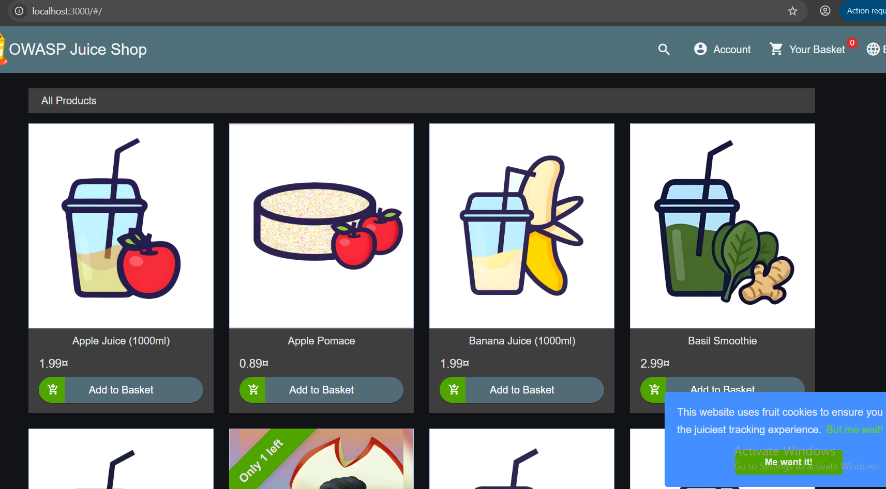
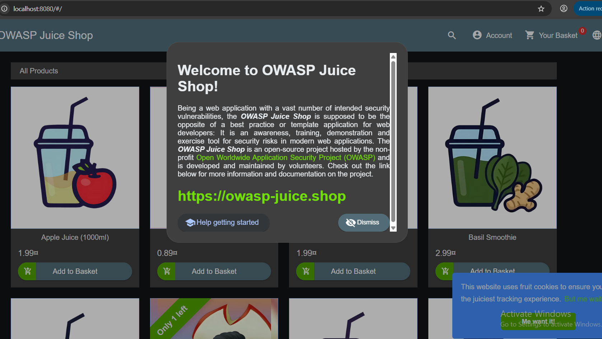

# Lab 1 — Dựng WAF trên Nginx

## Mục tiêu

Chạy OWASP Juice Shop phía sau Nginx + ModSecurity + OWASP CRS. Cổng 3000 là đường truy cập trực tiếp để đối chiếu; cổng 8080 là đường đi qua WAF.

## Cấu hình

File docker-compose.yml ở thư mục gốc của repo khai báo:

- web: bkimminich/juice-shop, publish cổng 3000.
- waf: owasp/modsecurity-crs:nginx, publish cổng 8080.
- BACKEND=http://web:3000.
- MODSEC_RULE_ENGINE=On để bật phát hiện và chặn.
- BLOCKING_PARANOIA=1.

## Cách chạy

Mở terminal tại thư mục repo và chạy:

    docker compose config --quiet
    docker compose up -d
    docker compose ps

Mở http://localhost:3000 và http://localhost:8080. Cả hai địa chỉ phải hiển thị Juice Shop; yêu cầu qua cổng 8080 được chuyển tới web:3000 qua Nginx.

## Kết quả và bằng chứng

- compose-check.txt: cấu hình Compose hợp lệ và các service/giá trị theo đề.
- service-and-http-check.txt: trạng thái hai container và HTTP 200 ở cả hai địa chỉ.
- nginx-runtime-excerpts.txt: Nginx bật ModSecurity, proxy tới web:3000, setup.conf nạp CRS setup và rules.
- web-browser.png: trang Juice Shop trực tiếp ở cổng 3000.
- waf-browser.png: trang Juice Shop qua WAF ở cổng 8080.

Phần thử SQL injection, đăng nhập hợp lệ và xem luật 942100 là nội dung của slide 2/2; bằng chứng nằm trong evidence/lab2.

Dừng lab bằng:

    docker compose down

## Ảnh minh chứng

### Truy cập trực tiếp — cổng 3000

### Truy cập qua WAF — cổng 8080

