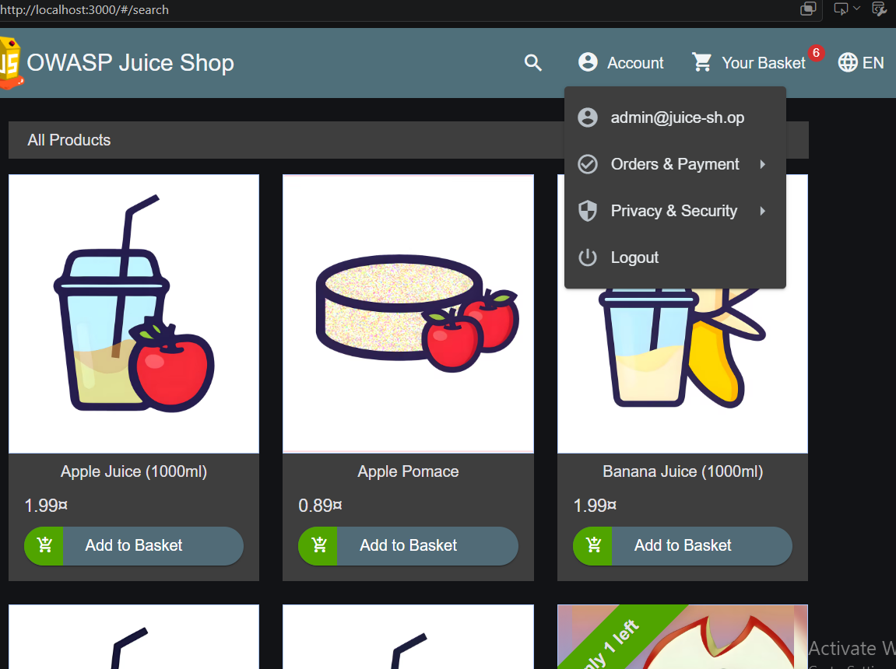
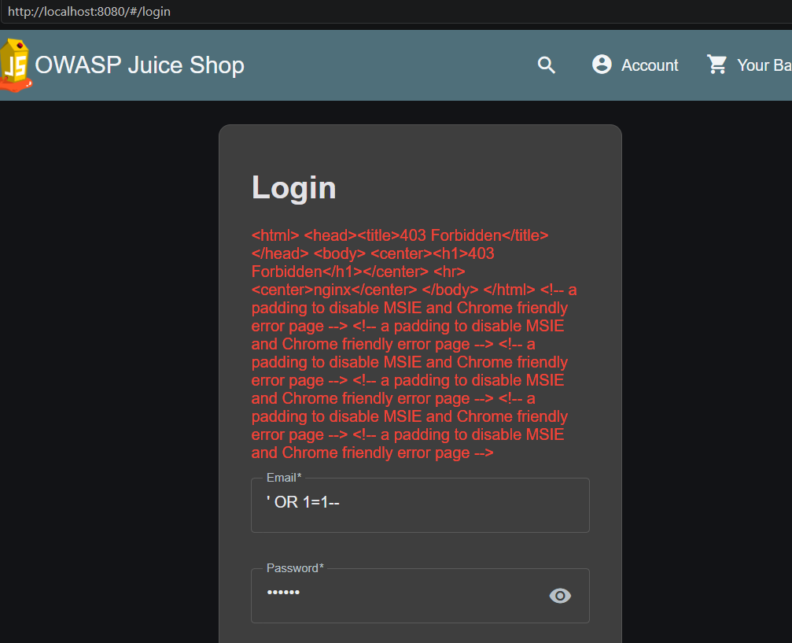
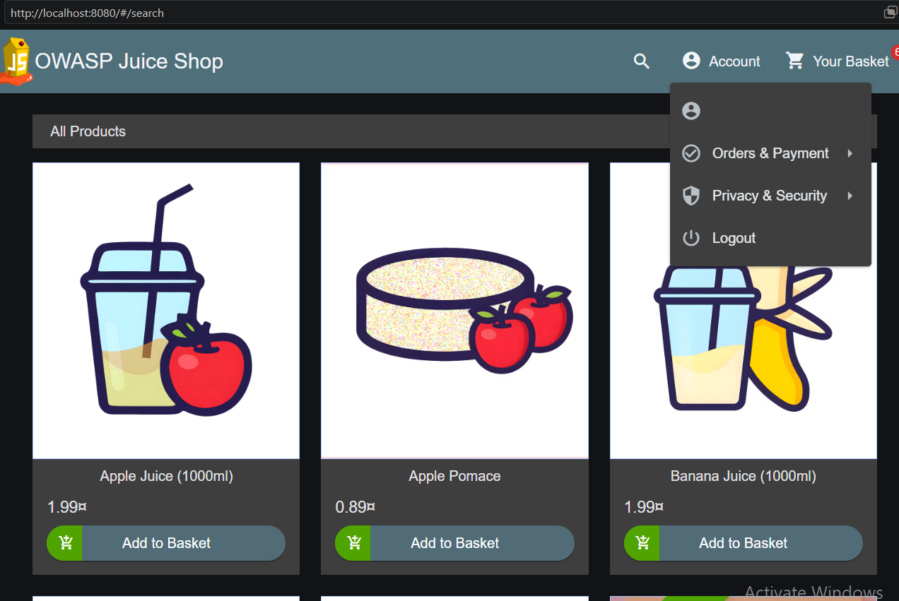

# Lab 2 — Kiểm tra SQL injection và khả năng chặn của WAF

## Mục tiêu

So sánh thử đăng nhập SQL injection khi truy cập Juice Shop trực tiếp ở cổng 3000 và khi đi qua Nginx + ModSecurity + OWASP CRS ở cổng 8080. Đồng thời kiểm tra đăng nhập hợp lệ qua WAF và đối chiếu log CRS.

## Điều kiện bắt đầu

Tại thư mục gốc repo, chạy:

    docker compose up -d
    docker compose ps

Mở Juice Shop ở `http://localhost:3000` để truy cập trực tiếp và `http://localhost:8080` để đi qua WAF.

## Các bước thực hiện

1. Tại `http://localhost:3000`, mở Login; nhập email `' OR 1=1--` và mật khẩu bất kỳ. Kết quả mong đợi: đăng nhập thành công.
2. Tại `http://localhost:8080`, thử lại cùng payload. Kết quả mong đợi: `403 Forbidden`.
3. Tại `http://localhost:8080`, đăng nhập bằng `admin@juice-sh.op` / `admin123`. Kết quả mong đợi: đăng nhập thành công.
4. Kiểm tra log WAF:

       docker compose logs --no-color waf

   Tìm luật `942100` hoặc thông điệp `SQL Injection Attack Detected` để xác nhận CRS phát hiện request SQLi.

## Kết quả đã ghi nhận

| Trường hợp | Đường truy cập | Kết quả |
|---|---|---|
| Thử SQLi | Trực tiếp, cổng 3000 | HTTP 200; đăng nhập thành công |
| Cùng payload SQLi | Qua WAF, cổng 8080 | HTTP 403; không đăng nhập được |
| Đăng nhập hợp lệ | Qua WAF, cổng 8080 | HTTP 200; đăng nhập thành công |
| Phân tích log | WAF | Luật CRS 942100 phát hiện SQLi |

## Bằng chứng

- [http-results.json](http-results.json): kết quả HTTP và xác thực của ba trường hợp; không lưu cookie hoặc token.
- [waf-detection.txt](waf-detection.txt): tóm tắt luật 942100, tham số bị phát hiện và kết quả 403.
- [waf-logs.txt](waf-logs.txt): trích log WAF thật có thời gian, URI, HTTP 403, luật 942100 và message CRS; header chứa cookie/token đã được loại bỏ.
- [admin-login-direct-3000.png](admin-login-direct-3000.png): ảnh đăng nhập thành công qua cổng trực tiếp 3000.
- [sqli-waf-8080-blocked.png](sqli-waf-8080-blocked.png): ảnh WAF trả `403 Forbidden` với payload SQLi qua cổng 8080.
- [valid-login-admin-waf-8080.png](valid-login-admin-waf-8080.png): ảnh đăng nhập hợp lệ qua WAF cổng 8080 bằng `admin@juice-sh.op` / `admin123`.

### Đăng nhập trực tiếp — cổng 3000

### SQLi bị WAF chặn — cổng 8080

### Đăng nhập hợp lệ qua WAF — cổng 8080

Kết quả minh họa sự khác nhau giữa truy cập trực tiếp và truy cập qua WAF: CRS chặn payload SQLi, trong khi đăng nhập hợp lệ vẫn hoạt động qua cổng 8080.

